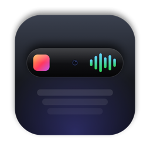
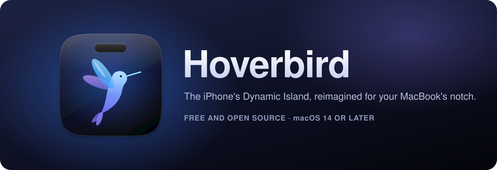
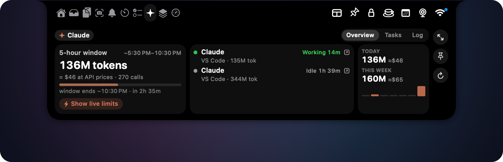
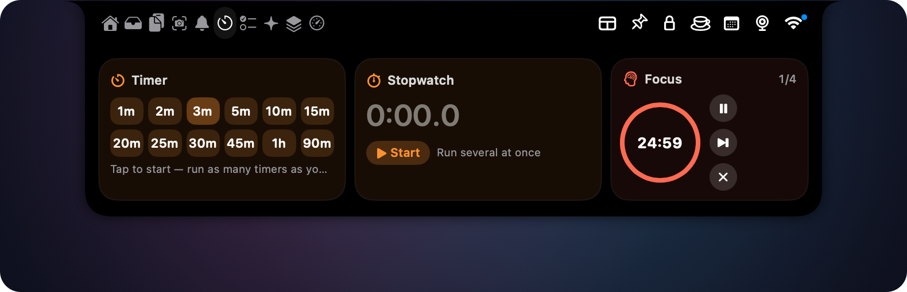
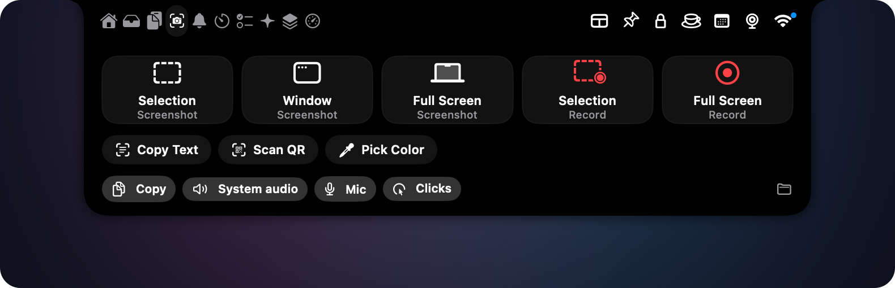
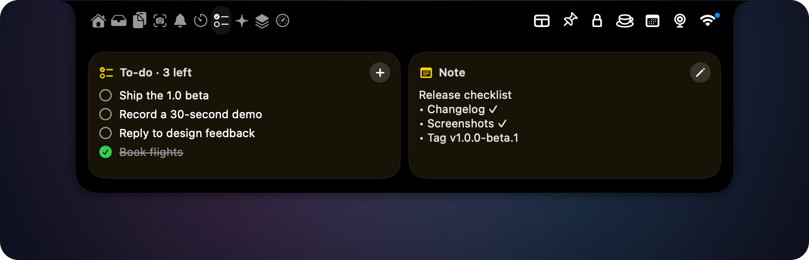
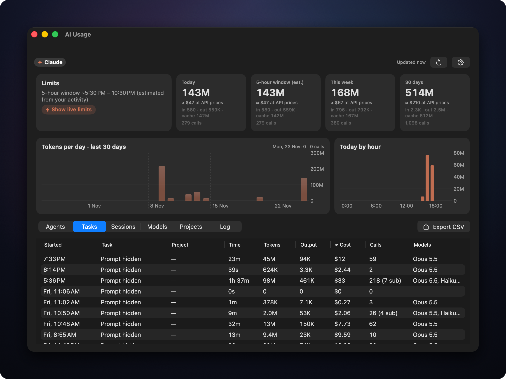

<div align="center">



# Hoverbird

**The iPhone's Dynamic Island, reimagined for your MacBook's notch. Free and open source.**

[](https://github.com/prashanth-manchikatla/Hoverbird/actions/workflows/ci.yml)
[](https://github.com/prashanth-manchikatla/Hoverbird/releases)
[](LICENSE)
[](#requirements)
[](https://developer.apple.com/swift/)

[**Download**](#install) · [Features](docs/features.md) · [Build from source](docs/building.md) · [Privacy](docs/privacy.md) · [Discussions](https://github.com/prashanth-manchikatla/Hoverbird/discussions)



</div>

---

Hoverbird turns the notch on your MacBook into a living, iPhone-style **Dynamic Island**. Hover it to open a
glass panel with your media, timers, notes, AI usage and more; while you work, it shows live activities
around the camera — a recording, a timer, an AI agent that needs your permission — the way an iPhone does.

It is built to disappear when you don't need it: every feature is **event-driven**, so it idles at
**~0 % CPU** with a small memory footprint, and **nothing leaves your Mac** unless you turn on a feature that
says so.

## Highlights

<table>
<tr>
<td width="50%" valign="top">

### ✦ AI usage, live
See your **Claude Code**, **Codex**, **Gemini CLI** and **Grok CLI** usage at a glance: the 5-hour and weekly
limits with a pace marker, tokens per prompt, running agents and what they're doing, and alerts before
you hit a limit. API accounts (OpenRouter, OpenAI, DeepSeek) too.

</td>
<td width="50%" valign="top">



</td>
</tr>
<tr>
<td width="50%" valign="top">



</td>
<td width="50%" valign="top">

### 🍅 Focus, timers & stopwatches
Pomodoro focus sessions with breaks, streaks and generated focus sounds (brown, pink, white noise,
ocean). Run any number of timers and stopwatches side by side — the closed island keeps counting.

</td>
</tr>
<tr>
<td width="50%" valign="top">

### 📸 Capture & screen tools
Screenshots and screen recordings, plus **Copy Text** from anything on screen (on-device OCR),
**Scan QR** and **Pick Color** — the tools people usually pay for.

</td>
<td width="50%" valign="top">



</td>
</tr>
<tr>
<td width="50%" valign="top">



</td>
<td width="50%" valign="top">

### ☑︎ Notes & to-dos
A to-do list and a quick note, one hover away. Tick things off right in the island; a small glass
panel opens for typing without stealing focus from your app.

</td>
</tr>
</table>

<p align="center">
  
  <br><sub>The AI Usage window: limits with pace, 30-day history, and tables for tasks, sessions, models, projects and every call — all exportable to CSV.</sub>
</p>

## Everything it does

| | |
|---|---|
| **Live Activities** | Recording, timers, iPhone orders & rides, iPhone Live Activities, next meeting, media, Awake — one primary activity wraps the camera, a second floats as a bubble, iPhone-style. |
| **Media** | Now Playing for every app (Music, Spotify, browsers, web apps), lyrics, visualizer — and the playing **video itself** in the artwork. |
| **AI Usage** | Limits, tokens, tasks, sessions, running agents and alerts for Claude Code, Codex, Gemini CLI, Grok CLI and API accounts. |
| **Focus** | Pomodoro sessions, focus sounds, streaks, 20-20-20 eye-break reminders. |
| **Notes** | To-dos and a quick note, saved only on your Mac. |
| **Camera** | A mirror on every tab; photos, video with sound, full screen. Uses your Mac's camera, with a one-click switch to a nearby iPhone (Continuity Camera). |
| **Capture** | Screenshots, screen recording (system audio + mic), Copy Text (OCR), Scan QR, Pick Color. |
| **Clipboard** | History of text, links, colours, images and files; pinning; tracking stripped from copied links; paste as plain text. |
| **Notifications** | Mirrors notification banners (including your iPhone's), with read, copy OTP, open, mark read and clear. |
| **Meetings** | Mute the microphone for every app at once (⌃⌥M), a "Muted" indicator during calls, camera-in-use alerts, one-click Join for upcoming meetings. |
| **Windows** | Snap layouts (halves, thirds, quarters…), a live mini-map to arrange windows, quit apps. |
| **Devices** | AirPods and Bluetooth batteries, charging, connectivity, battery alerts at your levels, downloads and drives. |
| **Monitor** | CPU (per cluster), GPU, memory, power and temperatures — no admin rights needed. |
| **Awake** | Keep the Mac awake for a while, until a time, or with the lid closed. |

See **[docs/features.md](docs/features.md)** for the complete tour.

## Install

### Download

1. Download **Hoverbird-*version*.zip** from the [latest release](https://github.com/prashanth-manchikatla/Hoverbird/releases).
2. Unzip it and drag **Hoverbird.app** to **Applications**.
3. Open it. macOS will say it can't verify the developer — Hoverbird isn't notarized yet — so go to
   **System Settings › Privacy & Security** and click **Open Anyway** (you only do this once).
4. Grant the permissions you want (see below). Hoverbird starts at login from then on.

> [!NOTE]
> Release builds are ad-hoc signed, so after installing an update macOS may ask for permissions again.
> Building from source with a local signing identity avoids that — see [docs/building.md](docs/building.md).

### Build from source

Only Apple's Command Line Tools are needed — no Xcode, no package manager:

```bash
git clone https://github.com/prashanth-manchikatla/Hoverbird.git
cd Hoverbird
./Scripts/build.sh --install   # builds, installs to /Applications and launches
```

Details, options and troubleshooting: **[docs/building.md](docs/building.md)**.

### Requirements

- macOS 14 Sonoma or later (macOS 26 Tahoe recommended; Liquid Glass and some extras need it)
- A Mac with Apple silicon. Designed for MacBooks with a notch; it also works on displays without one.

## Permissions

Hoverbird asks only for what a feature needs, and every feature works on its own.

| Permission | Used for |
|---|---|
| Accessibility | Notification mirroring, media fallbacks, window snapping, ⌘C ⌘C, paste |
| Screen & System Audio Recording | Screenshots, screen recording, the live video in the artwork, Copy Text |
| Camera / Microphone | The mirror, photos and videos (the mic is on only while recording) |
| Calendars | Upcoming meetings and the Join button |
| Location | Weather, and the Wi-Fi network name |
| Bluetooth | AirPods and accessory batteries |

**Optional:** *AI Usage › Show live limits* reads the sign-in Claude Code already keeps in your Keychain
(macOS asks first). Read **[docs/privacy.md](docs/privacy.md)** for exactly what each feature touches.

## Keyboard shortcuts

| Shortcut | Action |
|---|---|
| ⌘⇧I | Open or close the island |
| ⌃⌥C · ⌘C ⌘C | Open the clipboard |
| ⇧⌘2 | Copy text from the screen |
| ⌃⌥M | Mute / unmute the microphone |
| ⌃⌥V | Paste as plain text |
| ⌃⌥A | Keep the Mac awake |
| ⌃⌥ ← → ↑ ↓ · ↩ · ⌫ | Snap the front window to a half · fill · restore |
| ⌃⌥ D / F / G | Snap to the left / center / right third |

All shortcuts can be changed in Settings.

## FAQ

<details>
<summary><b>Does it slow my Mac down?</b></summary>

No. Hoverbird reacts to system events instead of polling — file-system events, power, audio and
network notifications — so it idles near 0 % CPU. Heavier work (live video, the system monitor) only runs
while that view is open.
</details>

<details>
<summary><b>How does AI Usage know my limits without an API key?</b></summary>

Claude Code, Codex, Gemini CLI and Grok CLI already write detailed logs on your Mac; Hoverbird reads
them locally. For the exact percentages Claude Code shows in `/usage`, you can opt in to *Show live
limits*, which uses Claude Code's own sign-in. See [docs/privacy.md](docs/privacy.md).
</details>

<details>
<summary><b>Can it track ChatGPT or Grok chats in the browser?</b></summary>

Chat apps don't record token usage on your Mac, so there is nothing to read. Hoverbird tracks the
**Codex** limits of your ChatGPT plan, **Grok CLI** and SuperGrok credits, and API accounts.
</details>

<details>
<summary><b>Will it work without a notch?</b></summary>

Yes — on external displays and Macs without a notch the island floats at the top center of the screen.
</details>

## Roadmap

Hoverbird is in **beta**. Next up: answering an agent's permission prompts from the island, file actions
on the Shelf (convert, compress, remove background, merge PDFs), a teleprompter, and a world clock. Ideas
are welcome in [Discussions](https://github.com/prashanth-manchikatla/Hoverbird/discussions/categories/ideas).

## Contributing

Bug reports, ideas and pull requests are all welcome. Start with **[CONTRIBUTING.md](CONTRIBUTING.md)** —
it covers the build, the project layout and the few principles that keep Hoverbird fast. Please follow
the [Code of Conduct](CODE_OF_CONDUCT.md), and report security issues privately as described in
[SECURITY.md](SECURITY.md).

## Credits

Hoverbird is built on **[boring.notch](https://github.com/TheBoredTeam/boring.notch)** by TheBoredTeam
and its contributors, whose work made this project possible. It also uses
[Defaults](https://github.com/sindresorhus/Defaults),
[KeyboardShortcuts](https://github.com/sindresorhus/KeyboardShortcuts),
[LaunchAtLogin](https://github.com/sindresorhus/LaunchAtLogin-Modern),
[SwiftUI-Introspect](https://github.com/siteline/swiftui-introspect),
[SkyLightWindow](https://github.com/Lakr233/SkyLightWindow),
[MacroVisionKit](https://github.com/TheBoredTeam/MacroVisionKit),
[mediaremote-adapter](https://github.com/ungive/mediaremote-adapter), and code adapted from
[NotchDrop](https://github.com/Lakr233/NotchDrop), [DynamicNotchKit](https://github.com/MrKai77/DynamicNotchKit),
[Calendr](https://github.com/pakerwreah/Calendr) and [Parrot](https://github.com/avaidyam/Parrot). See [NOTICE](NOTICE) and
[THIRD_PARTY_LICENSES](THIRD_PARTY_LICENSES).

Hoverbird is an independent project and is not affiliated with Apple, Anthropic, OpenAI, Google or xAI.

## License

Hoverbird is free software, licensed under the **[GNU General Public License v3.0](LICENSE)**.
